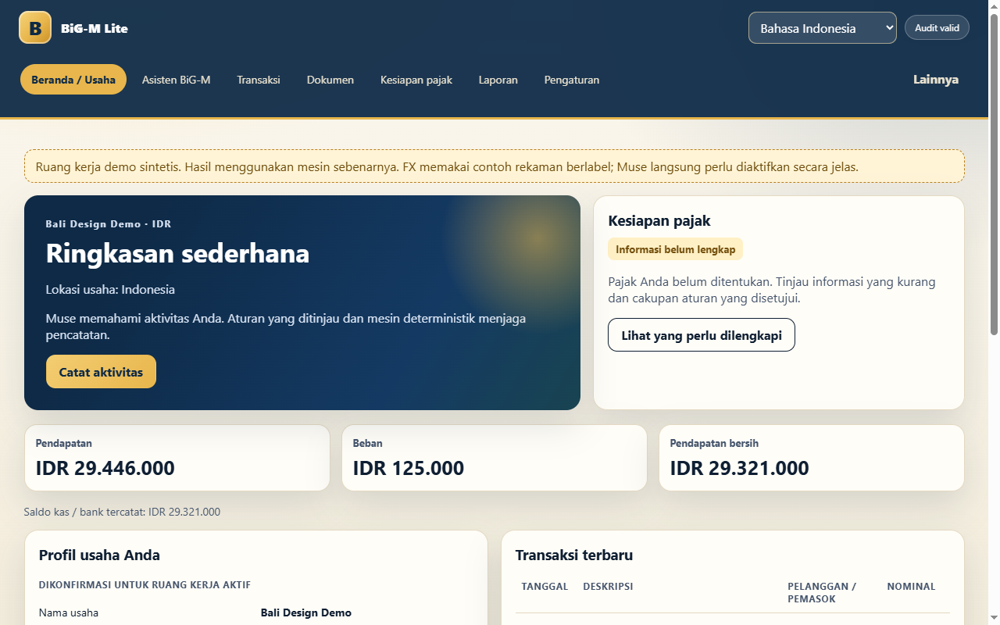
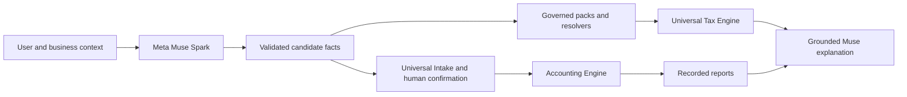

# BiG-M Lite

**Understand the business. Review the rules. Keep reliable books.**

BiG-M Lite is a hackathon prototype for freelancers and small businesses working across languages, documents and borders. A business owner can describe what happened, review the proposed facts and transactions, and obtain accounting results from one deterministic financial backbone.

Small businesses should not have to translate their lives into accounting software before they can use it. BiG-M separates understanding from authority: Meta Muse Spark interprets conversations and documents; governed content and deterministic resolvers handle applicability; existing engines calculate and record; the user confirms consequential actions.



## What works in the demo

The primary persona is an Australian freelancer operating in Bali with Singapore clients. Nationality, work location, registration, tax residence, customer location, UI language and currency remain independent.

- Indonesian and English UI, with regional English locale support and exact-money Intl formatting.
- Muse onboarding, profiling, corrections and grounded follow-up questions through the Meta Model API.
- Local OCR/text extraction for PDF, PNG/JPEG, text and simple statement CSV, followed by candidate interpretation and human review.
- Conversation, documents, direct entry and generic external imports converge on one existing intake/posting boundary.
- Original SGD values remain visible alongside explicitly reviewed historical IDR conversion.
- Business facts, actual missing tax information, candidate CountryPack/TreatyPack governance and recorded reports are visible in the product.
- Muse explanations select grounded facts and engine results. The model does not author accounting amounts or approve tax law.

The prepared synthetic demo posts three real journals: IDR 1,500,000 local revenue, IDR 125,000 receipt expense, and SGD 2,000 revenue converted at the recorded rate of 13,973 IDR/SGD for 2026-06-01. Engine totals are **IDR 29,446,000 revenue**, **IDR 125,000 expenses**, **IDR 29,321,000 net before tax**. Tax remains unresolved rather than displaying zero.

## Why Meta Muse Spark

Muse supplies the semantic layer shared by business profiling, document/transaction understanding and contextual explanations. Its structured outputs are validated against stable schemas with quoted evidence. The UI shows **Understood with Meta Muse Spark** only when a successful Meta interpretation actually supplied that result. Offline interpretations and unavailable responses have separate labels.

Live acceptance evidence is in [research/phase9-demo/live-acceptance.json](research/phase9-demo/live-acceptance.json). Routine tests never call the paid API.

## Architecture



There is one Accounting Engine and one Universal Tax Engine. CountryPack Fabric supplies governed candidate content, not a new engine for each country. Tax calculation is a separately scoped governed review; bookkeeping can continue while tax is unresolved. The complete maintainable [diagram source](docs/architecture/phase9.mmd) and [technical summary](docs/HACKATHON-TECHNICAL-SUMMARY.md) describe the existing boundaries accurately.

## Setup

Use Node **20.19 or newer** and npm.

```powershell
npm ci
Copy-Item .env.example .env
```

Keep credentials only in the ignored `.env` or your server environment. Never put a real key in `.env.example`, browser code, fixtures, evidence or a commit. The local environment loader preserves already-configured process variables.

| Variable | Purpose |
| --- | --- |
| `BIGM_META_API_URL` | Complete Meta Responses API endpoint, configured server-side |
| `BIGM_META_API_KEY` | Private server credential; never sent to the browser |
| `BIGM_META_MODEL` | An enabled Muse Spark model available to your account |
| `BIGM_MUSE_ENABLED` | Set `0` for deterministic offline behavior |
| `BIGM_MUSE_MAX_REQUESTS` | Normal server process request ceiling; default 100 |
| `BIGM_MUSE_TRACE` | Optional developer trace; default off |
| `BIGM_PORT` | Normal application port; default 3100 |
| `BIGM_DATA_PATH` | Normal application snapshot; default `data/store.json` |
| `BIGM_API_TOKEN` | Optional API authorization; API clients send a Bearer token |
| `BIGM_DEMO_LIVE` | Explicit live Muse opt-in for the isolated demo; default 0 |
| `BIGM_DEMO_PORT` | Isolated demo port; default 3109 |

The demo launcher uses its own snapshot path and ignores `BIGM_DATA_PATH`. It serves synthetic data on loopback without inheriting the normal application API token. Use the normal authenticated API for private user data; the demo is for synthetic fixtures only.

## Run the normal application

```powershell
npm start
```

Open [localhost:3100](http://localhost:3100). The server binds to `127.0.0.1`. Runtime state defaults to `data/store.json` and is ignored by Git. No setup automatically approves a legal rule or treaty benefit.

## Repeatable demo

For the shortest reliable product tour:

```powershell
npm run demo:prepare
npm run demo
```

Open [localhost:3109](http://localhost:3109). This starts the prepared offline demo, clearly labelled as synthetic, with three engine-posted transactions and a candidate tax review containing actual missing requirements. The recorded historical FX fixture is labelled; it does not pretend to be a new live rate lookup.

To start the complete onboarding journey instead:

```powershell
# Stop the demo server first.
npm run demo:reset
npm run demo
```

Reset replaces only the owned `data/demo/store.json`; it does not delete normal user data. It refuses an unmarked workspace, redirected paths or a running demo server. Sample receipt and Singapore invoice buttons are available only in demo mode. Synthetic scenario inputs are in [demo/journey.json](demo/journey.json).

To make Muse live during the tour, configure the ignored `.env` and explicitly opt in before starting:

```powershell
$env:BIGM_DEMO_LIVE='1'
npm run demo
# After stopping the server:
Remove-Item Env:BIGM_DEMO_LIVE
```

The live demo has a **12-request process ceiling and zero automatic retries**. Unchanged model requests use the existing bounded cache. Use the prepared tour for repeated navigation; use a fresh tour only when demonstrating onboarding. See the [rehearsal guide](docs/DEMO-REHEARSAL.md) for the exact story, review steps, expected totals and failure plan.

## Verification

```powershell
npm test
npm run test:demo
npm run security:scan
npm run test:demo:browser
```

Phase 9 regression: **402 tests passed**, including all 396 Phase 8 tests. Six new tests cover the primary HTTP journey, reset isolation, demo sample security, Meta outage behavior and product interaction contracts. The optional installed-Chromium rehearsal checks all seven primary views at desktop 1440x900 and laptop 1280x800, language switching and a grounded fallback explanation. It needs an installed Chrome/Edge/Chromium; set `BIGM_CHROME_PATH` when auto-detection does not find it. Browser rendering is additional to, and separate from, the standard deterministic test suite.

Controlled live acceptance skips unless explicitly enabled:

```powershell
$env:BIGM_META_LIVE_TEST='1'
npm run test:demo:live
Remove-Item Env:BIGM_META_LIVE_TEST
```

This command uses synthetic data and at most five Meta requests with zero retries. It is not part of `npm test`. The [Phase 8 FX command](docs/PHASE8-INTERNATIONAL-RUNTIME.md) remains the separate explicit public-provider verification; the demo itself uses the captured rate fixture.

## Governance, security and limits

Muse cannot approve rules, activate a workspace, bypass confirmation or directly post journals. Model/document/provider content is untrusted input. Exact-money calculation, validation, closed periods, mappings, duplicates, review hashes, historical rate persistence and idempotency remain deterministic. Optional trace contains allowed facts and provenance, never credentials or system prompts. Research acquisition continues to use the existing sanitizer.

The architecture supports governed CountryPacks for multiple jurisdictions; this prototype does **not** claim all-country support or automatic tax compliance. Existing real-source candidates have specific scopes and periods and are not automatically approved. Treaty research candidates do not establish relief. The UI reports tax readiness, not a fabricated liability; deeper governed calculation/review workflows remain documented in the Phase 3/4 reports.

Reporting-currency conversion, foreign multi-line journal conversion, unpaid invoice/accrual workflows, revaluation, consolidation, payroll and inventory remain outside the completed demo scope. Exact-date FX policy rejects unavailable/carry-back dates. OCR quality and live Meta availability can vary; original evidence, review and clearly labelled fallback remain available. The web UI is a local prototype, not a deployed multi-user service.

## Reports and submission material

- [Phase 9 completion and verification](docs/PHASE9-DEMO-SUBMISSION.md)
- [Demo rehearsal and fragile steps](docs/DEMO-REHEARSAL.md)
- [Technical summary](docs/HACKATHON-TECHNICAL-SUMMARY.md)
- [Architecture source](docs/architecture/phase9.mmd)
- [Browser rehearsal evidence](research/phase9-demo/browser-rehearsal.json)
- [Phase 8 international runtime](docs/PHASE8-INTERNATIONAL-RUNTIME.md)
- Earlier details: [Phase 5 intake/OCR](docs/PHASE5-DOCUMENT-INTAKE.md), [Phase 6 convergence](docs/PHASE6-UNIVERSAL-INTAKE.md), [Phase 7 Muse](docs/PHASE7-MUSE-RUNTIME.md), [Phase 3 tax contracts](docs/PHASE3-TAX-CONTRACTS.md), [Phase 4 governed packs](docs/PHASE4-PACKS-REPORT.md).

Submission materials follow the supplied Stage One requirements: demonstrate the product and make Meta API use observable. The official hackathon theme, full criteria and submission form were not supplied, so eligibility, scoring claims and final submission remain pending. This checkpoint is committed locally only; no automatic push or submission occurs.

## Global freelancer acceptance journey

The October 2026 synthetic journey exercises the final product with 15 international engagements, mixed-use card spending, advances, contractual client balances, reviewed historical FX and grounded Q&A. Dashboard/reports distinguish wages, business income, advances, personal/mixed purchases, card debt and provisional business results. Mixed allocation, asset policy, tax residence, withholding and unsupported CountryPack/TreatyPack applicability remain explicit review items.

Run `npm run test:global:freelancer` for the public HTTP journey, or `npm run test:global:browser` for installed-Chromium interaction and fresh-process restart/replay. Routine tests use mocked Muse transport and dated synthetic FX; no paid calls. See [the complete acceptance report](docs/GLOBAL-FREELANCER-E2E.md) for results, reruns, live evidence, security and remaining governance work. The original demo quick start remains available.

The Moroccan expat work includes a bounded live regulatory-research pilot with structured briefs, exact evidence, candidate-only governance and offline replay. The [research report](docs/MUSE-REGULATORY-RESEARCH.md) records the final four-request result and unresolved residence checks; it does not claim a completed Moroccan tax result.
