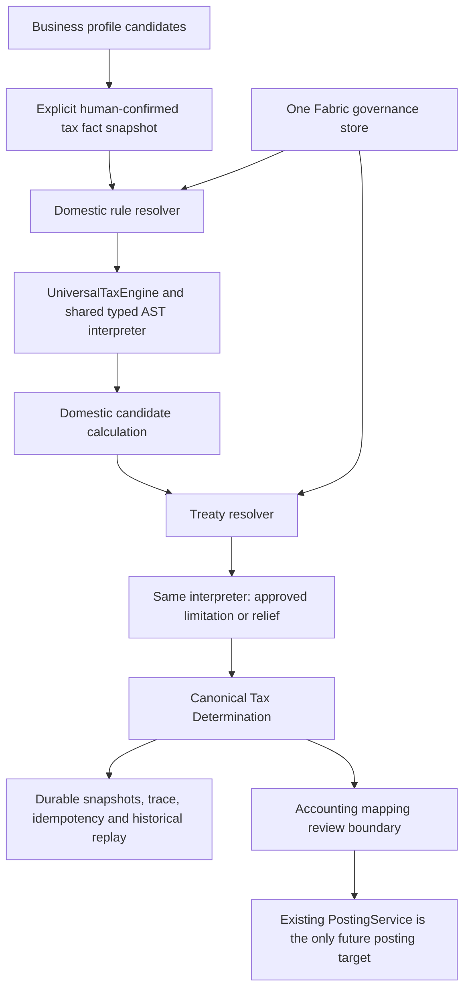

# Phase 3: Universal Lite Tax Engine and TreatyPack

Date: 29 October 2026 (Asia/Jakarta).
Branch: `codex/universal-lite-tax-engine`.
Protected parent: `4590c6e86ce14579a77545abc102c64fd987aed8`.
Previous accepted baseline: `8d63a32420ab3a50fa302945a990433efe74823d`.
Both remain ancestors; neither was rewritten. The starting working tree was clean. Local commit hash is supplied in the completion message; no push is performed.

## Result

Exactly one `UniversalTaxEngine` now executes validated declarative rules. There is one shared AST interpreter, no country-specific executor and no web access in the tax subsystem. CountryPack and TreatyPack supply versioned data through the same Fabric governance model. The authoritative Money, journal, PostingService, ledger, periods and accounting reports are unchanged.

The former simple tax rate action loop has been replaced. Its compatibility entry point delegates executable TEST ONLY work to the same universal engine; ungoverned legacy production actions return review status and no authoritative amount. Existing bookkeeping continues, with its zero tax journal delta explicitly separated from an undetermined liability. Posting report wording no longer presents that delta as a final tax amount.

All **168 previous tests** and **29 new Phase 3 tests** pass: **197 total, 0 failures**, 24 suites. Tests are offline, including actual process restart and CLI replay. No paid model calls were made.

## Architecture

The engine never fetches sources or receives executable JavaScript from a pack. Unknown law remains unresolved. VAT/GST/sales-type calculations can be expressed in the same rule contract. Income/CIT/simplified-income/WHT/credit contexts cannot disable cross-border review by setting a domestic pack hint to false. Treaty eligibility uses the same bounded AST interpreter; monetary treaty effects are applied only after the domestic candidate exists.

Production interfaces are the library `src/tax/index.js` and offline `scripts/tax-engine.js`. No new web calculator, automatic tax posting or UI redesign was added. Existing web bookkeeping and its workspace/tax-readiness distinction remain intact. The web's older source-content review endpoint is not an approval of the newly compiled executable version.

## Files created and changed

| Area | Files | Purpose |
|---|---|---|
| Shared governance | `src/fabric/candidates.js`, `governanceStore.js` | Extend existing reviewCandidate with exact executable-content hash binding; one durable collection for research, domestic and treaty candidates |
| Engine | `src/tax/taxEngine.js`, `dsl.js` | One neutral executor; typed bounded AST, exact rational intermediates and existing Money final rounding |
| Contracts and facts | `src/tax/contracts.js`, `facts.js` | Executable schemas, explicit fact roles, scoped human confirmation, rejected/unknown profile facts excluded |
| Resolution | `src/tax/contentRegistry.js`, `treatyResolver.js` | Shared governance consumer, scope/date/succession/conflict checks and exact treaty subset selection |
| History and boundary | `src/tax/determinationStore.js`, `accountingBoundary.js` | Atomic durable determinations, scoped idempotency/replay and non-posting accounting review plan |
| Existing material | `src/tax/referenceCandidates.js`, `index.js` | Adapt only already ported Original COMPANY/CIT 2025 formulas; register an incomplete ID-SG research candidate |
| Compatibility | `src/tax/legacyAdapter.js`, `src/app/verticalSlice.js`, `src/app/report.js` | Retain existing bookkeeping contracts, block unapproved legacy tax actions and expose undetermined liability clearly |
| Tools | `scripts/tax-engine.js`, `tax-demo.js`, `package.json` | Offline CLI and reproducible demonstrations |
| Evidence and examples | `research/phase3-tax/` | Candidate catalog, honest demo outcomes, explicitly TEST ONLY determination/request/facts, Original research test snapshot |
| Validation | `test/phase3-tax.test.js` | 29 focused tests, plus full previous regression |
| Documentation/config | This report, `PHASE3-TAX-CONTRACTS.md`, README, `.gitignore`, `.gitattributes` | Contract/use documentation and exact-byte treatment of the retained research snapshot |

## AST/DSL and rule contract

Runtime schemas are executable validators in `src/tax/contracts.js` and `validateAst` in `dsl.js`; they run on registration and again before approved content is eligible to execute. They reject unknown fields, undeclared references, invalid types/arity, unsafe object properties, functions, unsafe numeric representations and excessive size/depth. There is no eval, Function constructor, generated-code compilation, dynamic module name from a pack or network call.

Allowed operations: INPUT, PARAMETER, typed LITERAL, ADD, SUBTRACT, MULTIPLY, DIVIDE, MIN, MAX, GT, GTE, LT, LTE, EQ, AND, OR, NOT, IF and bounded ROUND. PARAMETER reads only a declared governed constant; there is no arbitrary object path or external lookup. IF/AND/OR short-circuit deterministically, without inventing missing values. Numeric operands are exact decimal strings or rational strings, never floating-point monetary inputs. Depth/node/trace and numeric-size limits bound execution.

The rule contract retains identity, tax/subject/event scope, required typed facts, applicability predicate, tax base, rate definition, amount formula, parameters/thresholds, explicit effective dates and final rounding, evidence references, treaty relevance and optional supersession links. Required review attestations are separate from applicability: an unapproved taxable-base reconciliation is unresolved, not a false predicate interpreted as no tax.

Intermediate arithmetic uses reduced BigInt rational values, not another Money implementation. Amount inputs are serialized instances of the existing Money contract. Final monetary results are produced through that same Money class and its multiplyRational rounding. Original base rounding and final rounding are copied from the existing source formulas; no country rounding rule was invented. No implicit FX or cross-currency arithmetic is supported.

See [detailed contracts and CLI](PHASE3-TAX-CONTRACTS.md).

## CountryPack integration and actual executable content

`TaxContentRegistry` is a typed consumer of the existing Fabric candidate/review model, not a second governance store. Registering a validated candidate establishes executor capability, not legal approval. Human approval binds the exact executable-content hash and all source hashes. Changing a formula, rate, rounding policy, date, scope or citation invalidates that binding. Research-only approval without the executable hash cannot enable execution. Retired and superseded states remain governed by the same review history.

Default real-law approvals granted by this implementation: **zero**.

| Content | Implemented capability | Default production state |
|---|---|---|
| `ID_CIT_DETERMINATION_2025` version 2, `ID_CIT_GENERAL_AND_ARTICLE_31E_2025` | Existing 2025 COMPANY formula translated structurally into typed DSL; exact source parameters, thresholds and rounding retained | CANDIDATE / REVIEW_REQUIRED until separate human approval of the executable version |
| Same pack, `ID_CIT_LISTED_COMPANY_REDUCTION_2025` | Existing second COMPANY formula retained, including explicit eligibility fact | CANDIDATE / REVIEW_REQUIRED; no listed-company eligibility inference |
| `ID_CIT_REFERENCE` M3 material | Preserved untouched as source reference; no reconciliation consumer recreated | Non-executable reference in the existing source catalog |
| Individual/freelancer income law | No such substantive rule exists in the already ported material | MISSING_APPROVED_RULE; not replaced with a COMPANY rule |
| Indonesia 2026 | No new rules or dates created | OUT_OF_PERIOD for the 2025 COMPANY rules |
| SG/AU/US/GB real domestic tax calculations | No governed substantive executable content imported or invented | MISSING_APPROVED_RULE |
| ID-SG treaty | Separate research candidate; no dates, rates, articles or legal coverage invented | TREATY_REVIEW_REQUIRED |

The adapter uses the existing `src/countrypack/content/indonesia-cit-determination-2025.json`. Its rule source was re-inspected directly in Original at commit `4d0da9a6acafc24f7db3778f66b4df6d7cf4764c`, path `src/taxCountryPackIndonesiaM5.ts`, Git blob `2b5e00229ffc36d503ce7e2952a17b03d0ff2fe1`. Original Number constants are converted once to bounded exact decimal strings; monetary inputs/calculation never use floating point.

Provenance distinguishes the hash of the retained local Original projection from the referenced legal documents. `sourceKind: PORTED_REFERENCE_NOT_NEW_LEGAL_CAPTURE` is explicit. Legal URLs/locators remain references; their presence and Original verification metadata are not a new Lite approval. The existing requirement for reviewed taxable income/M3 reconciliation and applicable CIT obligation remains an explicit confirmed prerequisite. No enterprise reconciliation engine was built.

## TreatyPack and cross-border behavior

TreatyPack is separate from CountryPack, with a bilateral identity, version/window, covered taxes, explicit residence/source/PE scope, income articles, withholding/relief metadata, required facts and evidence. A complete executable subset requires valid dates, source evidence, an exact article, typed eligibility predicate and constrained monetary effects. An incomplete draft may retain null dates but never executes, even if its research content is reviewed.

The resolver returns NOT_NEEDED, APPLICABLE, REVIEW_REQUIRED, MISSING_TREATY, OUT_OF_PERIOD, MISSING_FACT or CONFLICT. APPLICABLE requires an approved in-period subset and a true eligibility predicate. Required facts are never defaulted to false. Confirmed source and residence are required; customer location, bank location, nationality and work location do not create either. Exact income scope, pack versions, period and fact types are checked. Two active conflicting TreatyPacks are not arbitrarily ranked.

Approved data may express WITHHOLDING_LIMIT, ALLOCATION, EXEMPTION or CREDIT using the same DSL and explicit rounding. The resulting liability cannot be negative or exceed the domestic candidate, including before rounding. Missing, expired, incomplete or conflicting treaty support leaves final taxAmount null; an intermediate domestic amount is explicitly labelled DOMESTIC_CANDIDATE.

Original's ID-SG research test was inspected directly and retained byte-for-byte under `research/phase3-tax/original-id-sg-test.mjs` (Git blob `4cef5943b422d011521234df99c2822632710b6e`). It describes a bounded COMPANY ordinary-interest scenario with additional source/governance artifacts. That test is engineering research, not treaty legal evidence or freelancer-service support. It is read as bytes and never executed/imported. No rates or legal dates were transplanted from its arithmetic or comments.

## Demonstrations and coverage gaps

`npm run tax:demo` writes `research/phase3-tax/demo-results.json` and an explicitly TEST ONLY complete determination.

| Requested case | Actual result |
|---|---|
| A: Indonesian freelancer, 2025 | MISSING_APPROVED_RULE. The available port is COMPANY/CIT, so a real freelancer calculation cannot honestly be claimed. Synthetic freelancer execution is separately tested and clearly TEST ONLY. |
| B: Same temporal constraint, 2026 | Existing COMPANY 2025 scope gives OUT_OF_PERIOD with zero formula trace steps; accounting remains usable. |
| C: Freelancer, explicit ID residence and SG source | Missing domestic individual rule; treatyResult independently reports TREATY_REVIEW_REQUIRED. A foreign customer alone instead leaves SOURCE missing. |
| D: Australian nationality, ID registration/work and explicit ID tax residence | Selects ID context, not nationality. The demo COMPANY rule remains REVIEW_REQUIRED without approval. An individual cannot use that COMPANY rule. |
| Positive existing formula | Isolated TEST ONLY approval simulation of the Original COMPANY 2025 formula returns a deterministic calculation and replay. No production legal approval is granted. |
| Positive second country and treaty effects | Fictional TEST ONLY pack data proves another country, simple regimes, GST/sales-type calculations, WHT limitation, allocation/exemption and credit execute without changing engine code. |

Invented test rates/limits appear only in labelled fixtures; production registration rejects test evidence disguised as real content. Reading/replaying a persisted TEST ONLY determination through a production engine is blocked, and the accounting boundary rejects it. No test approval is persisted into the default real catalog.

## Persistence and idempotency

Fabric candidates and their reviews share one atomically persisted collection. Determinations have their own result/history store, not a governance store or ledger. Each record retains the scoped request, confirmed fact snapshot/revision, selected IDs/versions/content hashes, domestic/treaty source references, candidate versions necessary to explain resolution, engine version, exact calculation trace, result and integrity/calculation hashes.

Request keys are scoped by organisation and subject. Reusing a key for changed facts, revision, period or context is an explicit IDEMPOTENCY_CONFLICT. An exact replay returns the original record, including its pinned versions, even after the live catalog changes; use a new request key to request a new governed determination. It never silently recalculates the same key against a new law version. Historical replay uses retained version snapshots, compares the deterministic calculation hash and creates no new authoritative determination. A retired successor never causes old law to revive for new calculations.

Restart tests launch a fresh Node process, restore Fabric and result state, verify exact idempotency, and replay the old result after a new version was registered. Corrupt snapshots are rejected. Save failure leaves the in-memory idempotency/result stores unchanged. Persistence is for the Lite single-process local deployment; no multi-writer/distributed store was introduced.

## Accounting boundary

The engine imports no ledger, journal or posting service and performs no GL mutation. `accountingReviewPlan` verifies determination integrity and organisation/subject/currency, blocks unresolved or TEST ONLY records, and otherwise returns ACCOUNT_MAPPING_REVIEW_REQUIRED with an existing Money amount. It deliberately performs no posting. Any future mapped effect must use the existing PostingService. Existing sales/purchase/reversal/import continue through their original accounting path.

`src/domain/`, `src/accounting/`, `src/business/` and `src/dashboard/` have no diff against Phase 2. The only app-layer changes expose unresolved tax status and clarify reporting. The deprecated low-level finalTotalMinor field remains a compatibility bookkeeping delta; finalLiabilityMinor is null there. The web's existing no-final-liability behavior is preserved.

## Validation and remaining limits

Final regression: **197 passed, 0 failed**, including all previous 168. The 29 focused tests cover the requested engine/AST, arbitrary-code rejection, types, required facts, applicability, dates, supersession/conflicts, domestic execution, unsupported rules, treaty selection/missing evidence/date/eligibility, semantic country roles, readiness, exact trace, durable restart, historical replay/idempotency, second-country data, accounting boundary, resource/rounding/currency guards and the real offline CLI.

`npm run tax:demo` also passes. Normal tests make no live source or model calls. The Phase 2 registry/raw fixtures remain intact.

Known limits are explicit: real individual/freelancer rules are not ported; current real executable candidates require human legal/content review; ID-SG legal coverage is incomplete; SG SSO 403, US Code download 404 and Australian data API timeout remain recorded Phase 2 acquisition blockers and were not pursued. No 2026 law, treaty cap or relief was invented. Transfer pricing, CFC, group tax, deferred tax, litigation, payroll, enterprise reconciliation, customs/excise, consolidation, OCR, FX providers, new countries, external GL expansion and a UI calculator were not built.

Human review/confirmation are trusted local application actions using the existing explicit-actor/source contract. This phase does not introduce an identity provider or claim that actor labels authenticate a person. Runtime AI has no approval/posting capability and its profile outputs remain CANDIDATE_ONLY.

The exact bytes of the Original JSON projection used by the demonstration are additionally retained under research/phase3-tax/source-ports/, addressed by the source hash in the determination and indexed with the Original commit/blob metadata. Tests verify this archive against the retained determination. This preserves the actual port bytes independently of later edits or checkout line endings; it does not relabel them as downloaded legal text.
